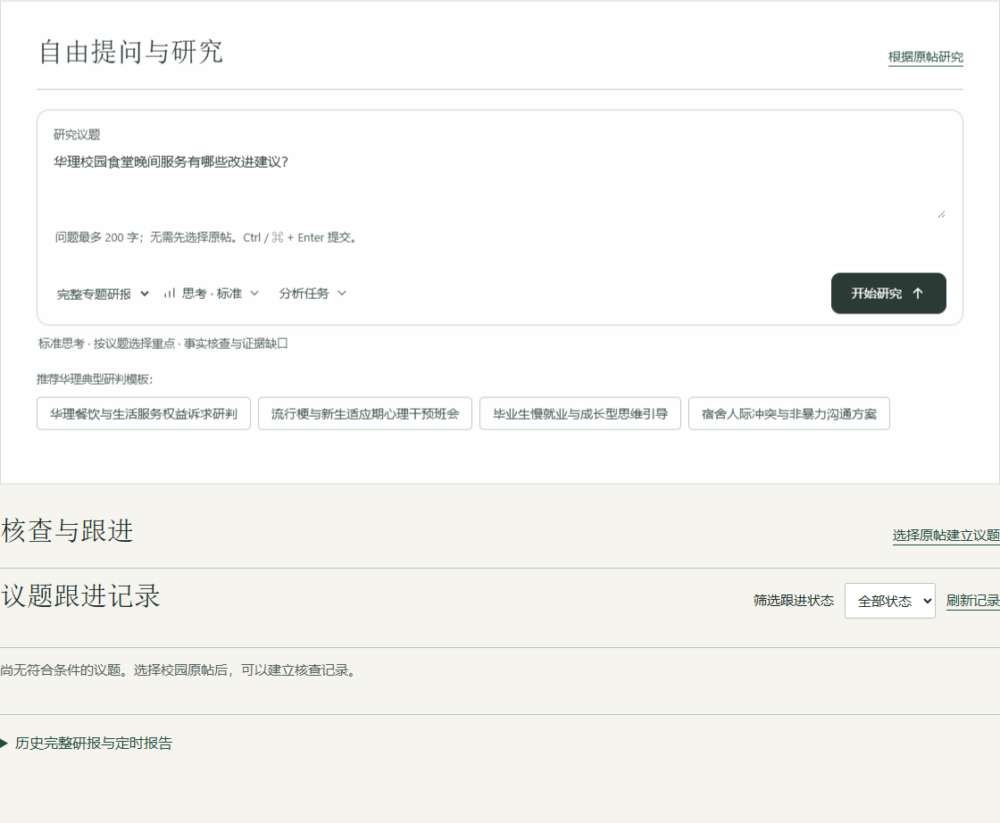
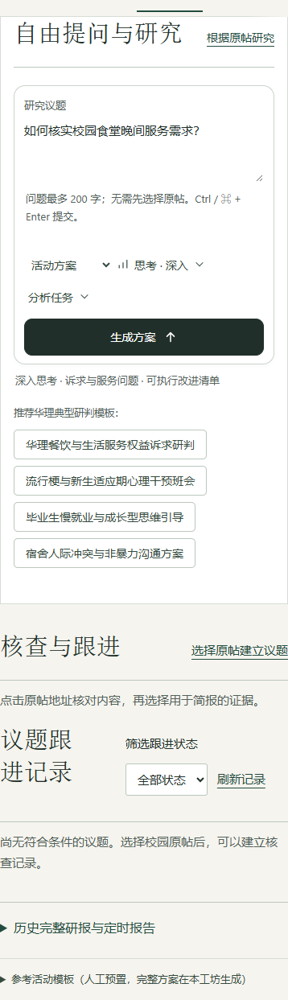

# 育人工坊提问恢复：验证记录

日期：2026-10-12。修复基于当天从运行容器取得的线上代码快照。

## 修改范围

业务文件仅 3 个：`production/templates/index.html`、与其同步的 `production/CampusPulse/templates/pulse.html`、`production/CampusPulse/blueprint.py`。自由提问默认显示在顶部；原帖研究和核查跟进仍独立可用。前后端明确限制问题为 200 字，拒绝超长和非文字输入；补充请求超时、避免轮询重叠及异常结果处理。未添加连续追问。

## 浏览器验证：通过

使用实际候选 HTML 和离线模拟接口验证默认入口、首页聚焦、校园问题转入提问、空输入与超长输入、三个思考模式的工作流、研究重点和交付要求、活动方案参数、429、模型失败、任务过期、未知状态、降级结果、缺失报告、结果阅读和原帖选择。桌面 1440px 与手机 390px 没有脚本错误。模拟接口只验证交互，不视为真实模型验收。

## 候选后端验证：通过

在现有应用容器启动独立进程，载入候选后端，使用临时数据库与模拟编排器；不修改运行中的应用。验证无效输入、200 字边界、三个工作流及选项传递、模型降级错误、429 和任务不存在 404。

## 真实免费模型验收：通过

通过候选 `/pulse/api/analyze` 提交问题，轮询直到完成，再通过 `/pulse/api/analysis/<id>` 读回报告。模型仅使用当前配置的 `poolside/laguna-s-2.1-free`，在独立进程禁用跨模型故障转移。实际请求以“尚无学校真实数据”的核查步骤为题，不虚构学校成效。

报告为 `formal`、没有模型降级、归档接口可读取。耗时约 138 秒；2 次模型调用，输入 5,986 Token、输出 710 Token，合计 6,696 Token。结果和用量写入临时 SQLite 数据库，不写生产记录。此结果证明本次验收时模型可用，后续可用性取决于网关。

## 发布状态及边界

线上业务版本尚未替换。服务器发布包与候选镜像准备好后，发布将只更新以上 3 个业务文件并重建应用容器，保留数据库和现有挂载。实际登录线上页面的人工验收尚未进行。原帖入口已有浏览器回归，但本次未对教师复核、导出和采集全流程逐项执行线上写入测试。

`SOURCE_MANIFEST.json` 和 `VERIFICATION.json` 属于原始备份的校验记录；当前候选业务文件的校验信息见发布包清单。不要把原始备份清单作为候选版清单使用。
